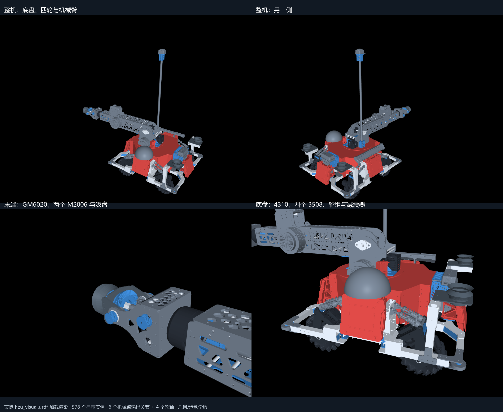

# HZU 工程机器人整机模型

本目录是独立的 **HZU 六轴机械臂 + 四轮底盘** 几何/运动学模型，与仓库原有 `arm_27` 三轴实机驱动是不同的机器人；其关节名字、数量和标定不能直接套用原有控制接口。



## 入口与内容

- `hzu_visual.urdf`：11 个 link、6 个机械臂输出关节、4 个轮轴。
- `meshes/visual/*.obj`：188 项米制网格，复用为 578 个显示实例。URDF 使用相对路径，整个目录可一起复制。
- 包含保存总装的底盘、四轮、机械臂、存矿、防护、减震和附件外形；十台主要电机为 4310×1、8009×2、GM6020×1、M2006×2、3508×4。
- `model_manifest.json`：来源、哈希、实例覆盖、link 分组、安装矩阵和简化说明。
- `validation.json`：原始导出阶段的全顶点读回、192 个来源文件哈希、12 项轮轴同轴和 27 组姿态检查。
- `joint_order.json`：机械臂与轮轴分开的输出坐标顺序，单位 rad；吸盘开关为独立动作。

原始 CAD 与未被 URDF 引用的重复 STL 不在本分发包中。网格已经是 m，不要再次乘以 0.001。根坐标沿用原始机械臂 CAD 坐标 A，`q=0` 是保存姿态，不是硬件编码器零位。

## 安装与查看

在仓库根目录执行，推荐单独的 Python 3.13 环境：

```powershell
python -m venv .venv-hzu
.venv-hzu\Scripts\python.exe -m pip install -r models/hzu_robot/requirements.txt

# 无硬件、无窗口：校验文件哈希，实际加载 URDF，逐轴设置姿态。
.venv-hzu\Scripts\python.exe tools/view_hzu.py --check

# 打开 MuJoCo 查看窗口，在右侧关节面板调整姿态。
.venv-hzu\Scripts\python.exe tools/view_hzu.py

# 离线生成整机图。
.venv-hzu\Scripts\python.exe tools/view_hzu.py --render hzu_preview.png
```

查看脚本通过 Python 读文件和 MuJoCo VFS 加载，支持 Windows 中文目录。不需要 SolidWorks，不连接任何硬件，不执行动力学积分。

## 验证与适用范围

原始导出由 MuJoCo 3.14.0 实际加载。全部保留网格顶点的最大导出差约 `6.98e-11 m`，27 组姿态下源 CAD 与导入网格的最大位置差约 `5.02e-14 m`。这证明了坐标导出和所指定关节随动的一致性，不代表所有机械约束已经实物验证。

当前适用于整机外形、装配与输出侧运动学检查。**没有可信的碰撞模型、实测惯量、实物行程和驱动控制参数，不能直接用作可信的接触/搬运仿真或 LeRobot 训练环境。**

- 六个机械臂关节导出为 `continuous` 仅提供无范围的检查坐标，不表示实物可以无限旋转。
- URDF 的 MuJoCo `boundmass=0.001`、`boundinertia=0.000001` 是仅用于显示模型编译的数值占位值，不是物理参数。
- 电机定转子、轴承内外圈为整体外形近似；差动输入相位、避震、麦轮滚子、万向接头和辅助机构保持 CAD 保存状态。
- 六个输出角到真实电机角的差动映射尚未标定；PyBullet 控制和 LeRobot 适配尚未建立。

## 几何来源

由用户提供的 HZU SolidWorks 总装及零件恢复，原始 CAD 未修改。大部分外形来自 SLDPRT 保存的显示网格；两个 8009、八个减震器及电磁阀用随附 STEP 小装配外形。相机视场锥、UWB 遮挡体与场外矿石示意已排除，实体硬件保留。

显示缓存读取使用 MIT 项目 [sldprt-format-research](https://github.com/blussyya/sldprt-format-research)，固定提交 `93b49335cfcd8b47e93878a0d9935c376a86169d`；装配证据读取使用 Apache-2.0 项目 [swformat](https://github.com/KenM76/swformat)，固定提交 `69b80c860241fdcbfa334f67cb951f76398c1a71`。这些是提取工具的许可证，不能视为原始 CAD/派生网格的许可证声明。原始文件路径和内容哈希保留在模型清单用于溯源。
